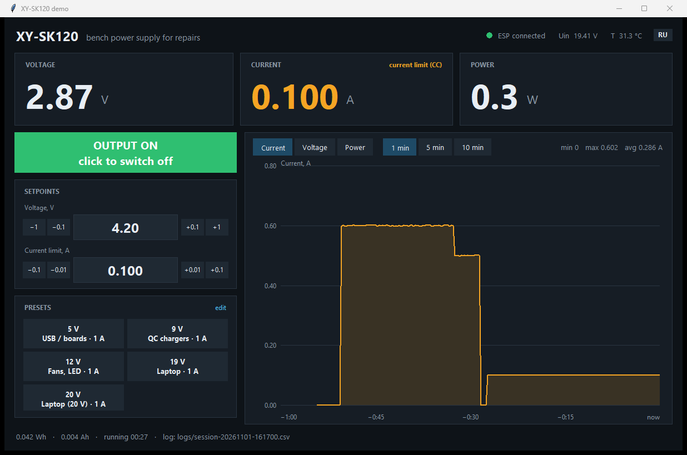
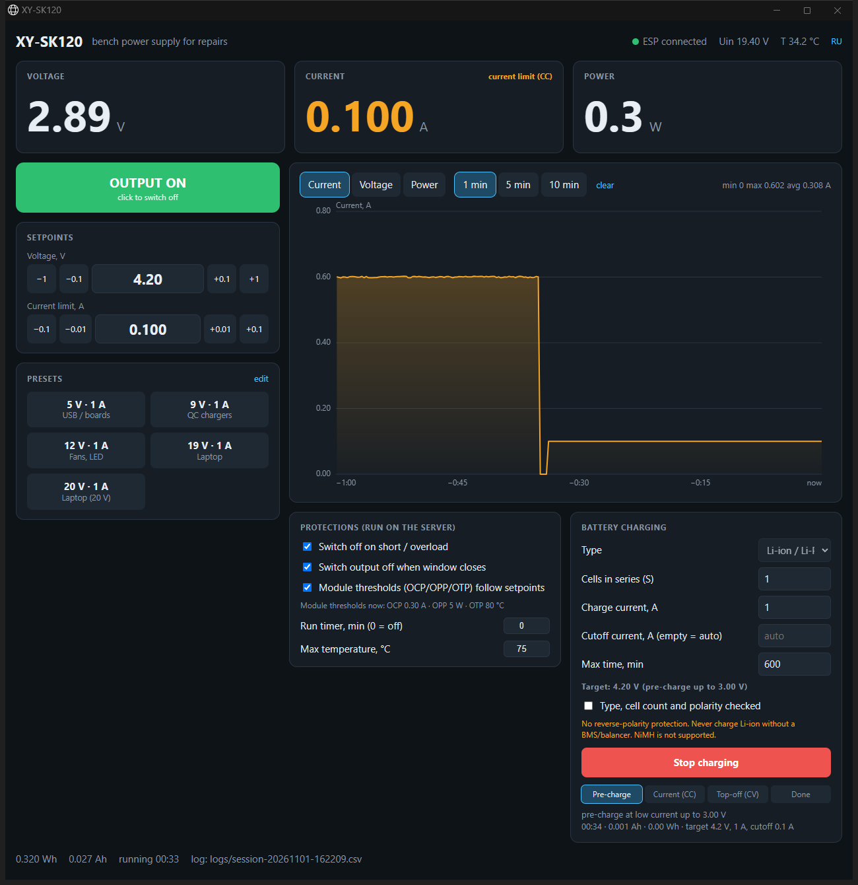
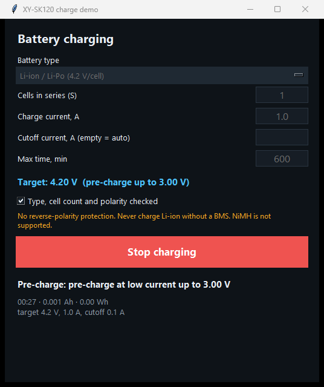

# XY-SK120 remote control (ESP32-C3 + ESPHome + desktop/web app)

🇬🇧 English · [🇷🇺 Русский](README.ru.md)

Turn a cheap **XY-SK120** buck-boost bench power supply module into a PC-controlled bench supply:
set voltage/current limit from your computer, switch the output on/off, watch live voltage/current/power
with a chart, use one-click presets (5 / 9 / 12 / 19 / 20 V), get protections that go beyond the module's own,
and charge batteries (Li-ion, LiFePO4, lead-acid) with a proper CC/CV profile — no need to reach for the module's buttons.

Built for laptop repair (19 V presets, short-circuit auto-off, current graph), but useful for any bench work.

| Desktop app (Python/tkinter) | Web UI (browser app window) |
|---|---|
|  |  |

*Screenshots are taken in `--demo` mode (simulated module). Russian UI: see [docs/screenshots](docs/screenshots).*

## How it works

```
XY-SK120 ──TTL UART (Modbus RTU, 115200)── ESP32-C3 SuperMini ──WiFi──┬── desktop.py   (tkinter window)
                                            (ESPHome firmware)         └── server.py    (web UI in Edge/Chrome app window)
```

* The ESP32-C3 talks Modbus RTU to the module's UART port and exposes everything through the encrypted ESPHome native API
  (so Home Assistant can use it too).
* `app/` is a Python app with a shared core (`core.py`) and two front-ends: a **desktop window** (`desktop.py`, tkinter, no browser)
  and a **web UI** (`server.py` + `static/index.html`). Both have a **Russian / English** switch.
* Over-the-air updates work out of the box — once flashed, you can close the case.

## Features

* Live U / I / P, CV/CC mode, input voltage, temperature, Wh/Ah counters, 10-minute chart with hover tooltip
* Output on/off (big button, `Space`; `Esc` = emergency off), setpoints with ± buttons, editable presets
* **Protections** (run in the app): auto-off on short circuit / overload, run timer, over-temperature, output off when the window closes
* **Smart hardware thresholds**: the module's own OCP / OPP / OTP are re-programmed to follow your setpoints
  (factory values 6.2 A / 125 W / 95 °C are useless at a 1 A limit)
* **Battery charger** (in the app): pre-charge → CC → CV → current cut-off, profiles Li-ion/Li-Po 4.20 V, LiFePO4 3.65 V, lead-acid 2.40 V per cell,
  timeout, over-voltage, "no battery" detection, optional external NTC limit
* CSV log of every output session (`app/logs/`)
* `--demo` mode: try the whole UI without any hardware (simulated load and battery)

<p align="center"><br><sub>Battery charging window (desktop app, demo mode)</sub></p>

## What you need

* XY-SK120 module (tested on the **old board revision**, firmware 139 / model code `0x5959`; SK120X should work too) with its 4-pin UART header
* ESP32-C3 SuperMini (any ESP32 board works with minor changes of pins)
* 3 wires + optional push-button; Python 3.10+ (tested 3.13) and [ESPHome](https://esphome.io) on your PC

## Quick start

### 1. Wire it — see [docs/wiring.md](docs/wiring.md)

The pin order on the module is **not labelled** and differs between board revisions — identify the pins with a multimeter first.

### 2. Flash the firmware

```bash
cd firmware
cp secrets.example.yaml secrets.yaml      # fill in WiFi, API key, OTA password
esphome run xy-sk120.yaml                 # first flash over USB, later: --device xy-sk120.local (OTA)
```

On Windows run ESPHome from **PowerShell/cmd**, not from Git Bash/MSYS (ESP-IDF refuses to build there).
If your module uses another speed/address, change `baud` / `modbus_addr` in the `substitutions:` block
(module menu: `bRE` baud, `Add` address). Defaults: 115200, address 1.

### 3. Run the app

```bash
cd app
pip install -r requirements.txt
set XY_API_KEY=<the xy_api_key from secrets.yaml>       # or put it into app/api_key.txt (one line)
python desktop.py            # desktop window
python server.py             # web UI in a standalone Edge/Chrome window
python desktop.py --demo     # no hardware: simulated module
```

The app connects to `xy-sk120.local` by default; use `--host 192.168.x.x` if mDNS does not resolve.
Language is picked from your system locale and can be switched with the **RU/EN** button (stored in `app/config.json`).

## Safety — please read

* The module has **no reverse-polarity protection** on its output. Check polarity before connecting a battery or a board.
* Never charge Li-ion/Li-Po packs without a BMS/balancer. The charger knows only series cell count and a CC/CV profile.
  **NiMH/NiCd are not supported.** A charge session is never a substitute for supervision.
* The app-side protections (short-circuit auto-off, timer, over-temperature, charger limits) work **only while the app is running**.
  The module's own hardware thresholds (OCP/OPP/OTP) are written into the module and work always.
* Registers other than the ones documented in [docs/registers.md](docs/registers.md) were not tested; writing unknown registers can misconfigure the module.
* You use this at your own risk (MIT license, no warranty).

## Troubleshooting

| Symptom | Fix |
|---|---|
| `no response received` in the ESP log | wrong baud/address, or TX/RX swapped — swap the two signal wires, check `bRE`/`Add` in the module menu |
| Current/power values 10× off | adjust `i_scale` / `p_scale` in `substitutions:` (current is raw/1000, power raw/100 on tested hardware) |
| ESP32-C3 SuperMini: `Auth Expired` / drops WiFi | keep `output_power: 8.5dB` (already in the config) |
| `xy-sk120.local` not found | use the IP address: `python desktop.py --host 192.168.x.x` |
| App says "no link to ESP" after enabling encryption | `XY_API_KEY` / `api_key.txt` must contain the same key as `xy_api_key` in `secrets.yaml` |

## Credits

Register map and protocol knowledge from the community: [csvke/XY-SK120-Modbus-RTU-TTL](https://github.com/csvke/XY-SK120-Modbus-RTU-TTL),
[donkilove/Sk150PowerSupplySDK](https://github.com/donkilove/Sk150PowerSupplySDK), [xy-modbus](https://docs.rs/xy-modbus),
[done.land XY-SK120X review](https://done.land/components/power/powersupplies/dc-dc-converters/plug&playconverters/xy-sk120x/),
[Sogolumbo/XYGUI](https://github.com/Sogolumbo/XYGUI). Not affiliated with the module's manufacturer.

## License

[MIT](LICENSE)
