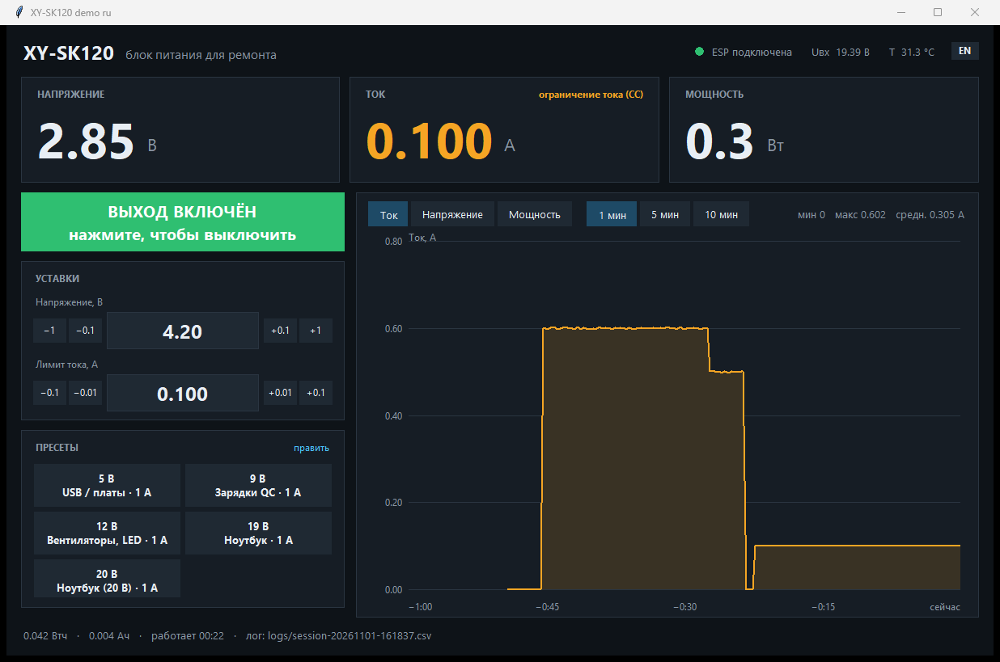
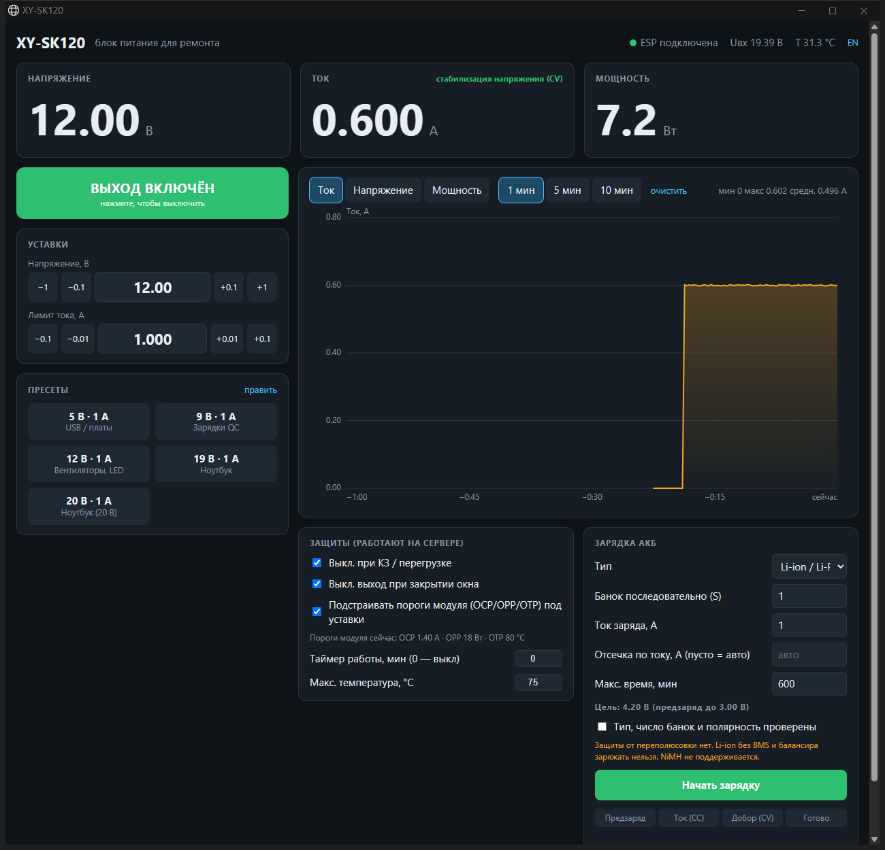
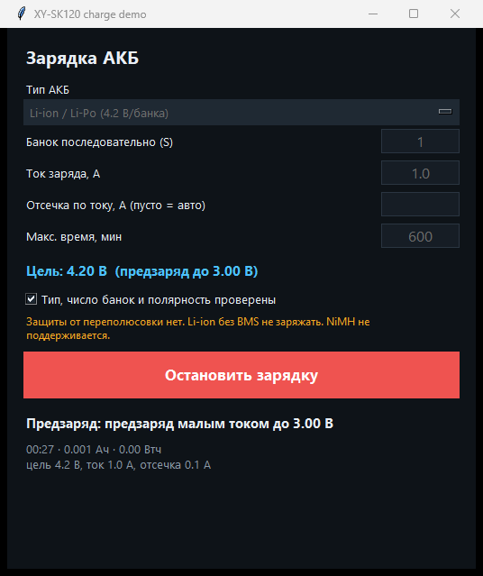

# Управление XY-SK120 по WiFi (ESP32-C3 + ESPHome + приложение для ПК)

[🇬🇧 English](README.md) · 🇷🇺 Русский

Превращает дешёвый повышающе-понижающий модуль **XY-SK120** в лабораторный блок питания, которым управляют с компьютера:
напряжение и лимит тока, включение выхода, живые U/I/P с графиком, пресеты в один клик (5 / 9 / 12 / 19 / 20 В),
защиты сверх встроенных и зарядка АКБ (Li-ion, LiFePO4, свинцовые) по нормальному профилю CC/CV —
без необходимости тянуться к кнопкам на модуле.

Сделан для ремонта ноутбуков (пресеты 19 В, автоотключение при КЗ, график тока), но подходит для любой работы за столом.

| Окно на Python (tkinter) | Веб-интерфейс (отдельное окно браузера) |
|---|---|
|  |  |

*Скриншоты сняты в режиме `--demo` (симулятор модуля). Английский интерфейс: [docs/screenshots](docs/screenshots).*

## Как это работает

```
XY-SK120 ──TTL UART (Modbus RTU, 115200)── ESP32-C3 SuperMini ──WiFi──┬── desktop.py   (окно tkinter)
                                            (прошивка ESPHome)         └── server.py    (веб-интерфейс в окне Edge/Chrome)
```

* ESP32-C3 говорит с модулем по Modbus RTU через его UART и отдаёт всё по зашифрованному нативному API ESPHome
  (поэтому Home Assistant тоже может с ней работать).
* `app/` — Python-приложение с общим ядром (`core.py`) и двумя интерфейсами: **окно на tkinter** (`desktop.py`, без браузера)
  и **веб-интерфейс** (`server.py` + `static/index.html`). В обоих есть переключатель **RU / EN**.
* Обновление прошивки по воздуху работает сразу: после первой прошивки корпус можно закрывать.

## Возможности

* Живые U / I / P, режим CV/CC, входное напряжение, температура, счётчики Втч/Ач, график за 10 минут с подсказкой под курсором
* Включение выхода (большая кнопка, `Пробел`; `Esc` — аварийное выключение), уставки с кнопками ±, редактируемые пресеты
* **Защиты** (работают в приложении): автоотключение при КЗ/перегрузке, таймер работы, перегрев, выключение выхода при закрытии окна
* **Умные аппаратные пороги**: встроенные OCP / OPP / OTP модуля перепрограммируются под ваши уставки
  (заводские 6.2 А / 125 Вт / 95 °C бесполезны при лимите 1 А)
* **Зарядка АКБ** (в приложении): предзаряд → CC → CV → отсечка по току; Li-ion/Li-Po 4.20 В, LiFePO4 3.65 В, свинец 2.40 В на банку;
  таймаут, перенапряжение, «нет АКБ», опциональный предел по внешнему NTC
* CSV-лог каждого включения выхода (`app/logs/`)
* Режим `--demo`: можно попробовать весь интерфейс без железа (симулятор нагрузки и АКБ)

<p align="center"><br><sub>Окно зарядки АКБ (приложение, демо-режим)</sub></p>

## Что понадобится

* Модуль XY-SK120 (проверено на **старой ревизии платы**, прошивка 139 / код модели `0x5959`; SK120X должен работать так же) с 4-контактным UART-разъёмом
* ESP32-C3 SuperMini (подойдёт любая ESP32, придётся поменять пины)
* 3 провода и по желанию кнопка; Python 3.10+ (проверено на 3.13) и [ESPHome](https://esphome.io) на ПК

## Быстрый старт

### 1. Подключение — см. [docs/wiring.md](docs/wiring.md)

Контакты на модуле **не подписаны**, порядок отличается у разных ревизий платы — сначала определите их мультиметром.

### 2. Прошивка

```bash
cd firmware
cp secrets.example.yaml secrets.yaml      # впишите WiFi, ключ API, пароль OTA
esphome run xy-sk120.yaml                 # первая прошивка по USB, дальше: --device xy-sk120.local (OTA)
```

В Windows запускайте ESPHome из **PowerShell/cmd**, а не из Git Bash/MSYS (там ESP-IDF отказывается собираться).
Если у вашего модуля другая скорость/адрес — поправьте `baud` / `modbus_addr` в блоке `substitutions:`
(меню модуля: `bRE` — скорость, `Add` — адрес). По умолчанию: 115200, адрес 1.

### 3. Приложение

```bash
cd app
pip install -r requirements.txt
set XY_API_KEY=<xy_api_key из secrets.yaml>       # или положите ключ в app/api_key.txt (одной строкой)
python desktop.py            # окно на Python
python server.py             # веб-интерфейс в отдельном окне Edge/Chrome
python desktop.py --demo     # без железа: симулятор модуля
```

По умолчанию приложение подключается к `xy-sk120.local`; если mDNS не работает — `--host 192.168.x.x`.
Язык выбирается по локали системы и переключается кнопкой **RU/EN** (хранится в `app/config.json`).

## Безопасность — прочитайте

* У модуля **нет защиты от переполюсовки** на выходе. Проверяйте полярность перед подключением АКБ или платы.
* Не заряжайте Li-ion/Li-Po без BMS/балансира. Зарядка знает только число банок и профиль CC/CV.
  **NiMH/NiCd не поддерживаются.** Зарядка не заменяет присмотр за АКБ.
* Защиты в приложении (автоотключение при КЗ, таймер, перегрев, лимиты зарядки) работают **только пока приложение запущено**.
  Аппаратные пороги модуля (OCP/OPP/OTP) записываются в сам модуль и работают всегда.
* Регистры, кроме описанных в [docs/registers.md](docs/registers.md), не тестировались; запись в неизвестные регистры может сбить настройки модуля.
* Вы используете это на свой риск (лицензия MIT, без гарантий).

## Если что-то не так

| Симптом | Что делать |
|---|---|
| `no response received` в логе ESP | неверная скорость/адрес или перепутаны TX/RX — поменяйте местами два сигнальных провода, проверьте `bRE`/`Add` в меню модуля |
| Ток/мощность врут в 10 раз | поправьте `i_scale` / `p_scale` в `substitutions:` (на проверенном железе ток = raw/1000, мощность = raw/100) |
| ESP32-C3 SuperMini: `Auth Expired` / падает WiFi | оставьте `output_power: 8.5dB` (уже есть в конфиге) |
| `xy-sk120.local` не находится | используйте IP: `python desktop.py --host 192.168.x.x` |
| «нет связи с ESP» после включения шифрования | `XY_API_KEY` / `api_key.txt` должны содержать тот же ключ, что `xy_api_key` в `secrets.yaml` |

## Благодарности

Карта регистров и знания о протоколе — от сообщества: [csvke/XY-SK120-Modbus-RTU-TTL](https://github.com/csvke/XY-SK120-Modbus-RTU-TTL),
[donkilove/Sk150PowerSupplySDK](https://github.com/donkilove/Sk150PowerSupplySDK), [xy-modbus](https://docs.rs/xy-modbus),
[обзор XY-SK120X на done.land](https://done.land/components/power/powersupplies/dc-dc-converters/plug&playconverters/xy-sk120x/),
[Sogolumbo/XYGUI](https://github.com/Sogolumbo/XYGUI). Проект не связан с производителем модуля.

## Лицензия

[MIT](LICENSE)
